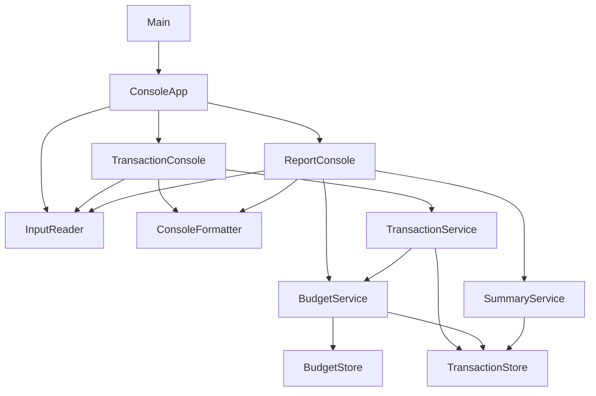

# Architecture

Status: **Approved by the human on 2026-11-12 (Stage 2 — Architecture Design), Revision 2.** Stage 3 (Design Review) completed and formally approved on 2026-11-12. All design-review findings (DR-001 to DR-004) resolved. Ready for Stage 4 (Implementation Planning).

Revision 2: resolves stakeholder decisions OQ-01 to OQ-08 and applies the architecture corrections requested for this revision. The AC-FR-003d clarification (C-1) was approved by the human on 2026-11-12 and is recorded in `docs/requirements.md` and §14.4. The AC-FR-006b clarification (C-2) was approved on the same date and is recorded in the same places.

Baseline: `docs/requirements.md` (Stage 1 approved, 2026-11-11). Base package: `org.capstone.expense` (assumption A-ARCH-01).

---

## 1. Context and Scope

### 1.1 System context

A single-user, interactive console application. The user runs `Main`, navigates a numbered menu, and records transactions. All state lives in JVM heap collections and is discarded when the process exits.

```
 User (keyboard / terminal)
        │  Scanner(System.in)            System.out (PrintStream)
        ▼                                        ▲
 ┌──────────────────────────── expense-tracker (one JVM process) ────────────┐
 │  console  ──►  service  ──►  storage (in-memory)                          │
 │     │            │                                                        │
 │     └──────────► model  ◄───────────────────────────────────────┘          │
 └───────────────────────────────────────────────────────────────────────────┘
```

### 1.2 Architectural drivers

| Driver | Source | Architectural consequence |
|---|---|---|
| Console-only I/O | NFR-004, C-007 | All I/O confined to `console` layer; `java.util.Scanner` (reading `System.in`) and `System.out` (PrintStream) only. File, network, and database I/O are prohibited. **[C-5 — Clarified 2026-11-12: console I/O via standard streams is an exception to the I/O prohibition.]** |
| In-memory only | NFR-003, C-008, A-014 | Storage uses `java.util` collections; file I/O (`java.io.*`, `java.nio.*`), database access (`java.sql.*`), and network I/O are prohibited in `src/main`. Console I/O via standard streams in the console layer is permitted. |
| Exact money | NFR-001, C-005 | `BigDecimal` everywhere; comparisons use `compareTo`; no `double`/`float`. |
| Calendar dates | NFR-002, C-006 | `java.time.LocalDate` only; parsing with `yyyy-MM-dd` and strict round-trip check. |
| Business rules testable without console | NFR-009 | Services hold all business rules and are unit-testable with no `Scanner`. |
| Non-blocking alerts | FR-009, OQ-002 | Alerts are returned as data; the console decides how to display them. |
| No input crashes | FR-010 | Validation errors are typed exceptions caught at the console boundary. |

### 1.3 Out of scope (from requirements)

Persistence, REST/HTTP, web/GUI, Spring or any DI framework, authentication, concurrency, cloud/external services, i18n, recurring transactions, export, and any clear-all/reset option. None of these appear in this design.

---

## 2. Architectural Style

**Layered architecture within a single Maven module**, with dependencies pointing downward only:

| Layer | Package | May depend on |
|---|---|---|
| Presentation (console) | `console` | `service`, `model`, `exception` |
| Application / business logic | `service` | `storage`, `model`, `exception` |
| Storage (in-memory) | `storage` | `model` |
| Domain model (values and enums) | `model` | (none; `java.math`, `java.time` only) |
| Errors | `exception` | (none) |

**Why this style.** The application has one use-case driver (console menu), one storage mechanism (heap), and about ten use cases. Hexagonal or event-driven styles would add ports, adapters, or buses that no requirement needs. A layered split is enough to keep business logic out of the console and keeps the code small enough to review in one pass.

**Composition.** There is no DI container. `Main` is the composition root: it creates the stores, the services, and the console, and wires them through constructors. Stores are created per application instance, never as static singletons, so tests get isolated state.

---

## 3. Package and Directory Structure

```
expense-tracker-capstone/
├── pom.xml                                   (existing; not modified by Stage 2)
└── src/
    ├── main/java/org/capstone/expense/
    │   ├── Main.java                         composition root; process entry point
    │   ├── console/
    │   │   ├── ConsoleApp.java               main menu loop, dispatch, top-level error boundary, EOF handling
    │   │   ├── TransactionConsole.java       flows: add expense, add income, list, edit, delete
    │   │   ├── ReportConsole.java            flows: spending summary, balance summary, set budget
    │   │   ├── InputReader.java              all prompts and parsing of typed input (wraps Scanner)
    │   │   └── ConsoleFormatter.java         table rows, money/percentage formatting, messages
    │   ├── service/
    │   │   ├── TransactionService.java       add / edit / delete / find / list transactions
    │   │   ├── BudgetService.java            set / get budgets; budget-alert evaluation
    │   │   └── SummaryService.java           spending-by-category and balance summaries
    │   ├── model/
    │   │   ├── Category.java                 interface shared by both category enums
    │   │   ├── ExpenseCategory.java          FOOD, TRANSPORT, SHOPPING, BILLS, HEALTH, ENTERTAINMENT, OTHER (enum)
    │   │   ├── IncomeCategory.java           SALARY, BUSINESS, INVESTMENT, OTHER_INCOME (enum)
    │   │   ├── TransactionType.java          EXPENSE, INCOME (enum)
    │   │   ├── DeleteOutcome.java            DELETED, CANCELLED (enum)
    │   │   ├── Transaction.java              immutable transaction entity (Lombok @Value, @Builder)
    │   │   ├── BudgetKey.java                (category, year, month) key (Lombok @Value)
    │   │   ├── CategorySpending.java         summary row (Lombok @Value)
    │   │   ├── BalanceSummary.java           summary result (Lombok @Value)
    │   │   ├── BudgetAlert.java              non-blocking alert data (Lombok @Value)
    │   │   └── TransactionResult.java        add/edit result: transaction + optional alert (Lombok @Value)
    │   ├── storage/
    │   │   ├── TransactionStore.java         ordered map of transactions; ID sequence
    │   │   └── BudgetStore.java              map of BudgetKey → monthly budget amount
    │   └── exception/
    │       ├── ValidationException.java      user-correctable input or rule violation (message shown to user)
    │       └── TransactionNotFoundException.java   requested transaction ID does not exist
    └── test/java/org/capstone/expense/
        ├── service/                          TransactionServiceTest, BudgetServiceTest, SummaryServiceTest
        ├── model/                            TransactionTest, CategoryTest
        ├── storage/                          TransactionStoreTest, BudgetStoreTest
        └── console/                          InputReaderTest, TransactionConsoleTest, ReportConsoleTest, ConsoleAppTest
```

Notes:
- The `service` package contains only the three service classes. NFR-009 / AC-NFR-009 require a TestNG test for every public method in that package, so the package must not contain public helper classes. `DeleteOutcome` therefore lives in `model`.
- No `util` or `common` package is introduced. Formatting lives in `console`, and parsing in `console.InputReader`.

---

## 4. Components and Responsibilities

| Component | Responsibility | Key operations | Depends on | Requirements |
|---|---|---|---|---|
| `Main` | Compose the object graph; start the console; return normally when the console returns (process exit status 0) | `main(String[])` | all | FR-010, NFR-004 |
| `ConsoleApp` | Numbered main menu; dispatch to flows; top-level error boundary; EOF handling; returns when the user chooses Exit | `run()` | `TransactionConsole`, `ReportConsole`, `InputReader`, `ConsoleFormatter` | FR-010, UC-01 |
| `TransactionConsole` | Collect inputs for add/list/edit/delete; print results and budget alerts | `addExpenseFlow()`, `addIncomeFlow()`, `listFlow()`, `editFlow()`, `deleteFlow()` | `TransactionService`, `InputReader`, `ConsoleFormatter` | FR-001–FR-005, FR-009 (display) |
| `ReportConsole` | Collect inputs for budget and summaries; print results | `spendingSummaryFlow()`, `balanceSummaryFlow()`, `setBudgetFlow()` | `SummaryService`, `BudgetService`, `InputReader`, `ConsoleFormatter` | FR-006–FR-008 |
| `InputReader` | Read lines from `Scanner`; validate syntax before constructing typed values; pick from enum lists; apply "blank = default" rules | `readLine`, `readOptionalLine`, `readMenuChoice`, `readAmount`, `readDate`, `readOptionalDate`, `readInt`, `readCategory`, `readConfirmation` | `Scanner`, `PrintStream` (for prompts) | FR-001, FR-002, FR-010, A-006 |
| `ConsoleFormatter` | Format money and percentages to 2 dp `HALF_UP`; format rows and warnings; no locale-dependent output | `money(BigDecimal)`, `percent(BigDecimal)`, `transactionRow(...)`, `budgetWarning(BudgetAlert)` | (none) | FR-003, FR-007, FR-009, NFR-001 |
| `TransactionService` | All transaction business rules: amount > 0, category-type match, ID lookup, filters, atomic add/edit/delete | `addExpense`, `addIncome`, `editTransaction`, `deleteTransaction`, `findById`, `listAll`, `listByCategory`, `listByDateRange` | `TransactionStore`, `BudgetService` | FR-001–FR-005, FR-009 (trigger) |
| `BudgetService` | Budget validation (year, month, amount); budget upsert; alert evaluation | `setBudget`, `getBudget`, `evaluateAlert` | `BudgetStore`, `TransactionStore` | FR-008, FR-009 |
| `SummaryService` | Totals by category, percentages, sorting; income/expense/net | `spendingByCategory`, `balanceSummary` | `TransactionStore` | FR-006, FR-007 |
| `TransactionStore` | Hold transactions in insertion order; provide lookup, replace, remove, and filtered reads; issue monotonic IDs | `nextId`, `save`, `replace`, `remove`, `findById`, `findAll`, `findMatching` | `Transaction` | FR-001, FR-002, A-004, NFR-003 |
| `BudgetStore` | Hold monthly budgets; overwrite on put | `put`, `find` | `BudgetKey` | FR-008, AC-FR-008b |
| `Transaction` | Immutable record of one income or expense; enforces type/category/amount invariants | builder, accessors, `toBuilder()` | `Category`, `TransactionType` | FR-001, FR-002, FR-004 |
| `Category` | Common type for `ExpenseCategory` and `IncomeCategory`; links each value to its `TransactionType`; case-insensitive name lookup | `transactionType()`, `name()` (enum), `fromName(String)` (static) | `TransactionType` | FR-003 (filter), FR-004, C-011, C-012 |

### 4.1 Dependency graph (no cycles)



`TransactionService` depends on `BudgetService` so that an add or edit can return the budget alert as part of its result. `BudgetService` never depends on `TransactionService`, so the graph is acyclic.

---

## 5. Domain Model

### 5.1 Types and relationships

```
«interface» Category                     (model)
    ▲                    ▲
    │                    │
ExpenseCategory      IncomeCategory        (enums)
  transactionType()=EXPENSE  transactionType()=INCOME

Transaction ──has──► Category
Transaction ──has──► TransactionType (EXPENSE | INCOME)
BudgetKey   = (ExpenseCategory, int year, int month)
BudgetStore : BudgetKey → BigDecimal
```

### 5.2 `Category` (interface) and enums

- `Category` declares `TransactionType transactionType()`. Both enums implement it.
- `ExpenseCategory` (FR-001, C-011): `FOOD`, `TRANSPORT`, `SHOPPING`, `BILLS`, `HEALTH`, `ENTERTAINMENT`, `OTHER`. Each returns `EXPENSE`.
- `IncomeCategory` (FR-002, C-012): `SALARY`, `BUSINESS`, `INVESTMENT`, `OTHER_INCOME`. Each returns `INCOME`.
- `static Optional<Category> fromName(String name)`: trims the input and matches it case-insensitively against all values of both enums. Used only by the list-by-category filter (FR-003, AC-FR-003b).
- **Invariant:** the names of all values across both enums are unique. This is what makes the category-name filter match only one category. It is covered by a test (Section 11.3).
- The enums and the `Category` interface carry no fields and do not use Lombok (Section 5.7).

### 5.3 `TransactionType`

`EXPENSE`, `INCOME`. Used for the type field, for filtering, and for the budget rule that only `EXPENSE` transactions count.

### 5.4 `Transaction`

| Field | Type | Rule | Mutability |
|---|---|---|---|
| `id` | `int` | Assigned by `TransactionStore`; ≥ 1; never reused (A-004) | final |
| `type` | `TransactionType` | Must equal `category.transactionType()` | final |
| `amount` | `BigDecimal` | Not null; `compareTo(ZERO) > 0` (A-003); any valid scale (ADR-016) | final |
| `category` | `Category` | Not null; belongs to `type` | final |
| `date` | `LocalDate` | Not null | final |
| `description` | `String` | Not null (empty string when blank); trimmed | final |

- Implemented as a Lombok `@Value` class with `@Builder(toBuilder = true)`. An edit produces a new `Transaction` via `toBuilder()` and replaces the stored instance under the same ID. Edits never mutate an object already in the store.
- Constructor validation: despite Lombok `@Value` and `@Builder`, the constructor must enforce all invariants (type/category match, amount > 0, non-null fields) and throw `IllegalArgumentException` if violated. These invariant checks are a safety net (Section 10.2). Services validate first and produce user-facing `ValidationException` messages, so the model check should not fire in normal use. If it does, it is a programming error and the application returns to the menu with "Unexpected error" (Section 10.2).

### 5.5 `BudgetKey` and monthly budgets

- `BudgetKey` = `(ExpenseCategory category, int year, int month)`, a Lombok `@Value` class with generated `equals`/`hashCode`. This is the unique key for FR-008 and A-008.
- `java.time.YearMonth` is not used as the key, because NFR-002 says all date values use `LocalDate`. An `int` pair keeps the key within the literal wording. Year and month are validated in `BudgetService` (Section 6.2).
- The stored value is a `BigDecimal` budget amount (> 0). A separate `MonthlyBudget` class is not created, because it would only duplicate `BudgetKey` plus one field.

### 5.6 Result and summary value types

| Type | Fields | Used by |
|---|---|---|
| `TransactionResult` | `Transaction transaction`; `Optional<BudgetAlert> budgetAlert` | `TransactionService.addExpense/addIncome/editTransaction` → console |
| `BudgetAlert` | `ExpenseCategory category`; `BigDecimal budget`; `BigDecimal monthlySpend`; `int year`; `int month` | `BudgetService.evaluateAlert` → console formatter (FR-009 message content) |
| `CategorySpending` | `ExpenseCategory category`; `BigDecimal total`; `BigDecimal percentage` (scale 2) | `SummaryService.spendingByCategory` → console |
| `BalanceSummary` | `BigDecimal totalIncome`; `BigDecimal totalExpenses`; `BigDecimal netBalance` | `SummaryService.balanceSummary` → console |

### 5.7 Lombok coverage (AC-NFR-007)

The following classes must carry a Lombok annotation. They are the domain model value classes in the `model` package.

| Class | Lombok annotations | Why |
|---|---|---|
| `Transaction` | `@Value`, `@Builder(toBuilder = true)` | Immutable entity; `toBuilder()` used for edits |
| `BudgetKey` | `@Value` | Value key with generated `equals`/`hashCode` |
| `CategorySpending` | `@Value` | Summary value |
| `BalanceSummary` | `@Value` | Summary value |
| `BudgetAlert` | `@Value` | Alert value |
| `TransactionResult` | `@Value` | Add/edit result value |

**Classes that do not use Lombok, by design:**
- `ExpenseCategory`, `IncomeCategory`, `TransactionType`, `DeleteOutcome`: enums with no fields.
- `Category`: interface.
- `ValidationException`, `TransactionNotFoundException`: exceptions.
- `TransactionService`, `BudgetService`, `SummaryService`, `TransactionStore`, `BudgetStore`, console classes, `Main`: behaviour classes with no boilerplate to remove.

**Interpretation approved (2026-11-12, §14.4 C-3).** AC-NFR-007 says "each domain model class". The approved reading is the six value classes above. Enums carry no fields to generate, so Lombok would have no effect on them. This is an interpretation, not a change to the requirement text.

`record` types are not used for model classes (ADR-011).

---

## 6. Service Design

Services hold all business rules. They never print, never read input, and never call `System.exit`. They signal failure with exceptions and return data.

### 6.1 `TransactionService`

| Operation | Input | Validation (service) | Effect | Returns | Errors |
|---|---|---|---|---|---|
| `addExpense(BigDecimal amount, ExpenseCategory category, LocalDate date, String description)` | Syntactically valid values; date already defaulted by console | amount non-null and > 0 (A-003); category non-null; date non-null; description trimmed (null → "") | Allocate ID; build `Transaction` (EXPENSE); save; evaluate budget alert | `TransactionResult` | `ValidationException` ("Amount must be greater than zero.") |
| `addIncome(BigDecimal amount, IncomeCategory category, LocalDate date, String description)` | As above | As above, for `IncomeCategory` | Allocate ID; save (INCOME); no alert | `TransactionResult` (alert empty) | `ValidationException` |
| `editTransaction(int id, TransactionType type, BigDecimal amount, Category category, LocalDate date, String description)` | Full target state; console has already resolved "blank = keep" to current values | Transaction exists (else not-found); amount > 0; `category.transactionType() == type`; date non-null | Build new `Transaction` via `toBuilder()`; `replace` in store; evaluate alert for the new category and month | `TransactionResult` | `TransactionNotFoundException`; `ValidationException` ("Category X is not valid for INCOME.") |
| `deleteTransaction(int id, boolean confirmed)` | ID; confirmation flag from console | Transaction exists (else not-found) | If `confirmed`: remove; else no change | `DeleteOutcome` (`DELETED` / `CANCELLED`) | `TransactionNotFoundException` |
| `findById(int id)` | ID | — | none | `Transaction` | `TransactionNotFoundException` |
| `listAll()` | — | — | none | `List<Transaction>` in insertion order (AC-FR-003a) | — |
| `listByCategory(String categoryName)` | Raw name | Resolved via `Category.fromName`; unknown name → `ValidationException` (resolved OQ-06) | none | `List<Transaction>` in insertion order | `ValidationException` |
| `listByDateRange(LocalDate start, LocalDate end)` | Two dates | Both non-null; `start.isAfter(end)` → `ValidationException` (resolved OQ-02; AC clarification in §14.4) | none | `List<Transaction>`, `start <= date <= end`, insertion order | `ValidationException` |

Atomicity rule: every mutating operation validates all of its inputs before it changes the store. A failed edit leaves the stored transaction exactly as it was (AC-FR-004c and FR-004 "retains current values").

### 6.2 `BudgetService`

| Operation | Input | Validation | Effect | Returns | Errors |
|---|---|---|---|---|---|
| `setBudget(ExpenseCategory category, int year, int month, BigDecimal amount)` | Category, year, month, amount | year in 1000–9999 (A-ARCH-03); month in 1–12; amount non-null and > 0 | `put` into `BudgetStore`; **overwrites** any existing value for the key (AC-FR-008b). Does not evaluate alerts (OQ-08). | `void` | `ValidationException` |
| `getBudget(ExpenseCategory category, int year, int month)` | Key parts | Year/month range check (same as above) | none | `Optional<BigDecimal>` | `ValidationException` |
| `evaluateAlert(Transaction transaction)` | A transaction that was just saved or edited | none (input is a stored, valid transaction) | none | `Optional<BudgetAlert>` | — |

`evaluateAlert` logic:

1. If `transaction.type() != EXPENSE` → empty.
2. Look up the budget for `(category, date.getYear(), date.getMonthValue())`. If absent → empty (FR-009, AC-FR-009c).
3. Sum all `EXPENSE` transactions in `TransactionStore` with the same category and the same year and month, starting from `BigDecimal.ZERO` and using `add`.
4. If `monthlySpend.compareTo(budget) >= 0` → return a `BudgetAlert` containing category, budget, and monthlySpend. Otherwise → empty (AC-FR-009b).

Using `compareTo` rather than `equals` is required. `500` and `500.00` are equal in value but not in `equals`, so `equals` would miss the 100% case (AC-FR-009d).

### 6.3 `SummaryService`

| Operation | Behaviour | Returns |
|---|---|---|
| `spendingByCategory()` | Filter `EXPENSE` transactions. Sum amounts per `ExpenseCategory` with `BigDecimal`. Compute the grand total. Drop categories whose sum is zero. For each remaining category, **independently**, `percentage = total × 100 ÷ grandTotal`, divided with `scale = 2`, `RoundingMode.HALF_UP`. Sort by total descending, ties by enum ordinal ascending. If there are no expenses, return an empty list; the console prints "No expense transactions recorded." | `List<CategorySpending>` |
| `balanceSummary()` | `totalIncome` = sum of `INCOME` amounts; `totalExpenses` = sum of `EXPENSE` amounts; `netBalance = totalIncome.subtract(totalExpenses)`. Each starts from `BigDecimal.ZERO`, so the empty case gives `0`, `0`, `0` (AC-FR-007b). | `BalanceSummary` |

**Percentage precision.** The division is done once, from the exact product `total × 100`, with no intermediate rounding. There is no `double` anywhere in this path (AC-NFR-001).

**Percentage tolerance (OQ-01 resolution).** Each percentage is rounded independently, so the sum of displayed percentages may differ from 100.00. The acceptable tolerance is:

> |Σ displayed percentages − 100.00| ≤ 0.005 × **n**, where **n** is the number of category rows actually displayed (categories with non-zero spend).

`n` counts displayed rows, not the total number of `ExpenseCategory` values. With one displayed category the sum is exactly 100.00 (tolerance 0.005). With seven displayed categories the tolerance is 0.035. The counterexample in Section 14.1 (sum 100.03 with n = 7) is within this tolerance.

AC-FR-006b states ±0.01 flat. This tolerance is the stakeholder-approved interpretation for implementation and tests. It is recorded in Section 14.4 as a clarification that needs formal baseline approval, since the AC text itself is unchanged.

---

## 7. Console Interaction Design

### 7.1 Entry point and wiring

```
Main.main
  ├─ Scanner scanner = new Scanner(System.in)            // single instance for the process
  ├─ PrintStream out = System.out
  ├─ Clock clock = Clock.systemDefaultZone()             // used only for default date (FR-001)
  ├─ TransactionStore txStore = new TransactionStore()
  ├─ BudgetStore budgetStore = new BudgetStore()
  ├─ BudgetService budgetService = new BudgetService(budgetStore, txStore)
  ├─ TransactionService txService = new TransactionService(txStore, budgetService)
  ├─ SummaryService summaryService = new SummaryService(txStore)
  ├─ InputReader in = new InputReader(scanner, out, clock)
  ├─ ConsoleFormatter fmt = new ConsoleFormatter()
  └─ new ConsoleApp(...).run()  →  returns when the user chooses Exit; main returns; process ends with status 0
```

Only one `Scanner` wraps `System.in`. Creating a second one would risk losing buffered input.

**Lifecycle.** `Main` wires dependencies, starts the console, and returns normally after `ConsoleApp.run()` returns. It does not call `System.exit`. No requirement justifies a forced exit: the application has no background threads, and the process ends when `main` returns. Exit status is 0 on normal completion.

### 7.2 Main menu

```
========== Personal Expense Tracker ==========
1. Add Expense
2. Add Income
3. List Transactions
4. Edit Transaction
5. Delete Transaction
6. Spending Summary
7. Balance Summary
8. Set Monthly Budget
9. Exit
Choose an option (1-9):
```

Numbers 1–8 map to UC-02 … UC-09 in the requirements. Exit is 9. The numbering is an architect assumption (A-ARCH-02) and is not specified in the requirements.

### 7.3 Flow rules (apply to every flow)

1. **Prompt with the expected format.** Dates prompt as `Date (yyyy-MM-dd, Enter = today):` in add flows (blank defaults to `LocalDate.now(clock)`). In edit flows, blank retains the current value. Amounts prompt as `Amount (e.g. 12.50):`. **[C-4 — Clarified 2026-11-12: blank date defaults to today in add flows; malformed and impossible dates are rejected.]**
2. **Abort to menu on the first validation error (OQ-07, resolved).** The error is displayed and the application returns to the main menu. A flow does not re-prompt the same field. Nothing is stored (AC-FR-001b, AC-FR-001c).
3. **Collect everything before acting.** A flow gathers all of its inputs first, then makes one service call. There is no partial state.
4. **Print the result, then any alert.** On a successful add or edit the console prints a confirmation line, then the budget warning if `TransactionResult.budgetAlert()` is present. The warning does not require acknowledgement and does not block the menu (FR-009).
5. **Menu is the only place where a flow starts.** Flows never call each other.

### 7.4 Flow specifics

| Flow | Prompts (in order) | Notes |
|---|---|---|
| Add Expense | Amount → Category (numbered `ExpenseCategory` list) → Date (Enter = today) → Description (optional) | Category list shows `1. FOOD` … `7. OTHER` |
| Add Income | Amount → Category (numbered `IncomeCategory` list) → Date → Description | Same shape; no budget alert |
| List Transactions | Filter menu: `1. All  2. By category  3. By date range` → (category name, or start and end dates) | Empty result prints "No transactions found." Filter errors (including unknown category name and start > end) abort to menu. |
| Edit Transaction | ID → show current values → Type (always prompted; `Enter = keep`, `1 = Expense`, `2 = Income`) → Amount (Enter = keep) → Category (**always** asked; numbered list for the resulting type) → Date (Enter = keep) → Description (Enter = keep) | Unknown ID aborts. Type is always prompted; pressing Enter retains the existing type. If type changes (user enters 1 or 2), category is re-selected from the new type's list (FR-004, A-010). **[DR-004 — Approved 2026-11-12: type prompt always displayed; Enter retains existing type.]** |
| Delete Transaction | ID → show full details → `Delete this transaction? (y/n):` | `y` → `deleteTransaction(id, true)`. `n` → "Deletion cancelled." Any other answer → error, no deletion. |
| Spending Summary | (none) | Table: category, total (2 dp), percentage (2 dp). Empty → message. |
| Balance Summary | (none) | Three labelled lines, all 2 dp, net may be negative. |
| Set Monthly Budget | Category (numbered `ExpenseCategory` list) → Year (4 digits) → Month (1–12) → Amount | Prints "Budget saved (overwrites any previous value)" when the key already existed. Setting a budget does not evaluate or show alerts (OQ-08, resolved). |

### 7.5 Input handling (`InputReader`)

- Every line is trimmed before parsing. Empty after trimming means "blank" for optional fields.
- **Amount syntax (OQ-05 resolution).** The trimmed text must match the plain-decimal pattern `^[+-]?\d+(\.\d+)?$` **before** any `BigDecimal` is constructed. The pattern:
  - accepts digits with an optional fractional part, and an optional leading sign;
  - rejects blank input, letters, scientific notation (`1e3`), thousands separators (`1,000`), a bare leading or trailing point (`.5`, `5.`), and embedded spaces;
  - does **not** impose a decimal-place limit. `12.5`, `12.50`, and `12.505` are all syntactically valid.
  - Signs are syntactically accepted so that `-5` produces the service's clear message "Amount must be greater than zero." rather than a syntax error.
  - Only then is `new BigDecimal(trimmedText)` called. The `NumberFormatException` path is therefore unreachable from user input and is still caught as a safety net.
- **Date (add flows).** Blank input defaults to the current date (`LocalDate.now(clock)`). Non-blank input: `LocalDate.parse(text, DateTimeFormatter.ofPattern("yyyy-MM-dd"))` followed by a strict round-trip check: `formatter.format(parsed).equals(text)`. This rejects malformed and impossible calendar dates that the default resolver may clip, for example `2026-02-30` or `2026-1-5` (ADR-010). `DateTimeParseException` becomes a `ValidationException` that names the expected format (NFR-002). **[C-4 — Clarified 2026-11-12: blank date = today; malformed/impossible dates rejected.]**
- Menu and list choices: `Integer.parseInt` inside try/catch, then a range check. Errors:
  - Non-numeric menu input → `"Invalid choice 'abc'. Please enter a number from 1 to 9."` (AC-FR-010a).
  - Out-of-range → `"Choice 12 is out of range. Please enter a number from 1 to 9."`
- Enum selection: the numbered list is printed from `Category` values for the given type. Input is parsed as an index. Out-of-range → `ValidationException`.
- Confirmation: `y`/`n`, case-insensitive. Anything else → error.
- **End of input (EOF).** `Scanner.nextLine()` throws `NoSuchElementException` when stdin closes (EOF). `ConsoleApp` catches this exception at the top-level loop, distinct from generic `RuntimeException` handling (see Section 10.2). On EOF, the application prints "Input closed. Exiting." and returns normally to `Main`, terminating the process with exit status 0. The application does not re-enter the menu loop; it exits cleanly. **[DR-001 — Resolved 2026-11-12: EOF handled separately; clean termination without menu re-entry.]** No additional exception type is introduced.

### 7.6 Output formatting (`ConsoleFormatter`)

- Money: `amount.setScale(2, RoundingMode.HALF_UP).toPlainString()`. No grouping separators and no locale call, so output is stable and English-only (A-013).
- Percentages: same, with scale 2.
- Transaction table columns: `ID | Type | Date | Category | Amount | Description`, with the date in `yyyy-MM-dd`. Each row is a single line. Amounts are shown at 2 dp; the stored value keeps its entered scale (ADR-016).
- Budget warning text (FR-009): `WARNING: FOOD budget of 500.00 reached for 2024-11. Total spend this month: 512.30.` It contains the category name, the budget amount, and the actual monthly total, all formatted to 2 dp using the same `ConsoleFormatter.money()` method (same rounding rules as all monetary display).

**Display-rounding implications (OQ-05).** Because stored amounts keep their precision, display rounding can make the printed figures differ slightly from exact arithmetic:
- A stored amount `12.505` is displayed as `12.51`. Totals and balances are computed exactly from stored values and then rounded for display only.
- A displayed column of amounts may not add exactly to the displayed total when stored values have more than 2 dp.
- Balance and budget comparisons use the exact stored values, so an alert decision is never based on the rounded display. Example: a budget of `500.00` with spend `499.996` is not alerted; the display shows `500.00`. The console does not show the 3-dp value, so this discrepancy is visible to the user and is recorded here as a known display effect.

---

## 8. In-Memory Storage Design

### 8.1 `TransactionStore`

- Backing structure: `LinkedHashMap<Integer, Transaction>`.
  - Insertion order is preserved for `listAll` (AC-FR-003a).
  - Lookup by ID is O(1).
  - No separate index is needed at this scale.
- ID sequence: a single `int nextId` field, initialised to 1. Each allocation returns the current value and increments it. Deletion never decrements or recycles, which meets A-004 and AC-FR-005a. Expenses and incomes share this one sequence.
- Operations:
  - `int nextId()`: allocate an ID.
  - `void save(Transaction)`: insert; the ID must not already exist.
  - `void replace(Transaction)`: overwrite the entry for an existing ID; the LinkedHashMap keeps the original position, so edits do not change list order.
  - `Optional<Transaction> findById(int)`.
  - `boolean remove(int)`.
  - `List<Transaction> findAll()`: returns an unmodifiable copy in insertion order.
  - `List<Transaction> findMatching(Predicate<Transaction>)`: returns an unmodifiable copy in insertion order. All filters and sums use this.
- Copies are returned so that callers cannot change the store's contents. `Transaction` is immutable, so the copies are safe to share.

### 8.2 `BudgetStore`

- Backing structure: `HashMap<BudgetKey, BigDecimal>`. Only the latest value per key is kept, which gives the overwrite behaviour of FR-008 with a plain `put`.
- Operations: `put(BudgetKey, BigDecimal)`, `Optional<BigDecimal> find(BudgetKey)`.

### 8.3 Lifecycle

Both stores are created in `Main` and are held in heap memory for the life of the process. Nothing is written to disk. Restarting the application starts with empty stores and ID 1 (A-014).

---

## 9. Main Workflows

**9.1 Add expense (UC-02, FR-001, FR-009)**
1. `ConsoleApp` reads choice `1` → `TransactionConsole.addExpenseFlow()`.
2. `InputReader` reads amount, category number, date (blank → `LocalDate.now(clock)`), description.
3. `TransactionService.addExpense(...)` validates amount > 0 → allocates ID from `TransactionStore` → builds `Transaction(EXPENSE)` → `save`.
4. `BudgetService.evaluateAlert(tx)` → sums EXPENSE for (category, month) → compares with budget using `compareTo`.
5. Returns `TransactionResult`. Console prints the confirmation, then the warning if present.

**9.2 Add income (UC-03, FR-002)** — same as 9.1 without step 4. `TransactionResult.budgetAlert` is empty.

**9.3 List transactions (UC-04, FR-003)**
1. Filter choice → `InputReader` collects the filter value(s).
2. `TransactionService.listAll()`, `listByCategory(name)` (resolves via `Category.fromName`; unknown name is an error), or `listByDateRange(start, end)` (rejects `start > end`).
3. Any `ValidationException` is displayed and the menu returns. Otherwise `ConsoleFormatter` renders rows, or "No transactions found."

**9.4 Edit transaction (UC-05, FR-004, FR-009)**
1. `TransactionService.findById(id)` → console shows current values. Missing ID → error and return to menu.
2. Console collects the new type (or keeps the current one), amount, category (always asked), date, and description. Blank fields are replaced by their current values here, so the service receives a complete target state.
3. `TransactionService.editTransaction(id, type, amount, category, date, description)` checks the category belongs to the type → creates the new `Transaction` through `toBuilder()` → `replace` in store.
4. `BudgetService.evaluateAlert(updated)` for the new category and month (FR-004: "budget alerts are re-evaluated for the transaction's category and month").
5. Console prints the confirmation and any warning.

**9.5 Delete transaction (UC-06, FR-005)**
1. `findById(id)` → console displays the full transaction.
2. Console prompts `y`/`n`.
3. `deleteTransaction(id, confirmed)` → `DELETED` or `CANCELLED`. The ID is never reused.

**9.6 Spending summary (UC-07, FR-006)**
`SummaryService.spendingByCategory()` → console prints rows sorted by the service, with 2 dp totals and percentages.

**9.7 Balance summary (UC-08, FR-007)**
`SummaryService.balanceSummary()` → console prints income, expenses, and net.

**9.8 Set budget (UC-09, FR-008)**
`BudgetService.setBudget(category, year, month, amount)` → validates year, month, and amount → `put` (overwrite). The console reports whether the key was new or replaced by calling `getBudget` before the write. No alert is evaluated (OQ-08).

**9.9 Budget alert check (FR-009)**
Triggered only by 9.1 and 9.4, inside the same operation. There is no separate alert screen and no background check.

---

## 10. Validation and Error Handling

### 10.1 Validation boundaries

| Concern | Console (`InputReader`) | Service | Model |
|---|---|---|---|
| Amount | Syntax: trimmed text matches `^[+-]?\d+(\.\d+)?$` before `BigDecimal` is constructed; no scale limit | Business: `> 0` | Invariant: non-null, `> 0` |
| Date | Syntax: `yyyy-MM-dd` + round-trip; blank → today (add/income) | Non-null | Non-null |
| Category | Index within displayed list | Belongs to the type | Invariant: `category.transactionType() == type` |
| Category name filter | Trim | Resolve case-insensitively; unknown → `ValidationException` | — |
| Date range | Syntax only | `start <= end` | — |
| Budget year | Integer syntax | 1000–9999 | — |
| Budget month | Integer syntax | 1–12 | — |
| Budget amount | Amount syntax (as above) | `> 0` | — |
| Transaction ID | Integer syntax | Exists | — |
| Delete confirmation | `y` / `n` | — | — |

The rule is: **syntax in the console, business rules in the service, invariants in the model.** Services produce the messages the user sees. The console displays them and does not add its own business logic.

### 10.2 Error classes

| Class | Meaning | Who creates it | Who handles it | User sees | Recovery |
|---|---|---|---|---|---|
| `ValidationException` (unchecked) | User input or rule violation; correctable | Console parsing, services | `ConsoleApp` boundary | `Error: <message>`; the menu returns | Return to main menu |
| `TransactionNotFoundException` | Requested ID does not exist | `TransactionService` | `ConsoleApp` boundary | `Error: No transaction with ID 42.` | Return to main menu |
| `NoSuchElementException` from `Scanner` | Input stream closed (EOF) | `Scanner.nextLine()` | `ConsoleApp` top-level loop (caught separately from generic errors) | `Input closed. Exiting.` | Exit application cleanly (status 0) **[DR-001 — Resolved 2026-11-12: distinct from generic RuntimeException handling; clean termination without menu re-entry.]** |
| `IllegalArgumentException` (from model) | Programming error: invariant broken by code that skipped validation | `Transaction` constructor | `ConsoleApp` boundary (generic fallback) | `Unexpected error. Returning to the menu.` | Return to main menu |
| Any other `RuntimeException` | Unexpected programming or system error | Anywhere | `ConsoleApp` boundary | `Unexpected error. Returning to the menu.` | Return to main menu |

Both custom exceptions (`ValidationException`, `TransactionNotFoundException`) extend `RuntimeException`. Checked exceptions would force `throws` clauses through the whole service layer without adding safety here. The stack trace is never printed to the user. FR-010 is met because the boundary catches all exceptions. For debugging, the implementation may write the stack trace to `System.err`. That is not a logging framework, so NFR-004 is not breached. `NoSuchElementException` is caught separately to distinguish EOF (clean exit) from programming errors (menu re-entry).

### 10.3 Edge cases (must be handled by the design)

| Case | Handling | Req |
|---|---|---|
| Amount `0`, `-5`, `0.00` | Syntax accepted; rejected by service with "must be greater than zero"; nothing stored | A-003, AC-FR-001b |
| Amount `abc`, empty, `1e3`, `1,000`, `.5`, `5.`, `12 50` | Rejected by `InputReader` before `BigDecimal` construction | FR-010, §7.5 |
| Amount `12.5` / `12.50` / `12.500` | Accepted; equal values compare equal with `compareTo` | NFR-001 |
| Amount `12.505` | Accepted and stored as `12.505`; displayed as `12.51` | OQ-05, §7.6 |
| Date blank | Defaults to today (add flows); keeps current value (edit) | FR-001, FR-004, A-002 |
| Date `2026-1-5`, `05/01/2026`, `2026-02-30` | Rejected (round-trip check) | NFR-002, AC-FR-001c, OQ-04 |
| Date `2024-02-29` | Accepted (valid leap day) | NFR-002 |
| Category number `0`, `8`, `abc` | Rejected | FR-010 |
| Category filter `food`, `FOOD`, `Food` | Accepted | FR-003, AC-FR-003b |
| Category filter `CAR` (unknown) | `ValidationException`; not an empty result (OQ-06) | FR-003 |
| Date range start == end | Included (inclusive) | A-012, AC-FR-003c |
| Date range start > end | `ValidationException`; console displays the error; no results (OQ-02) | FR-003, AC-FR-003d (clarification, §14.4) |
| Date range with no matches | "No transactions found." (not an error) | FR-003 |
| Edit: type change EXPENSE → INCOME | Category re-selected from income list; no longer in expense totals | FR-004, A-010, AC-FR-004b |
| Edit: category from wrong type | Rejected by service | FR-004 |
| Edit: non-existent ID | Error; store unchanged | AC-FR-004c |
| Edit: date moved to another month | Alert evaluated for the new month only | FR-004 |
| Delete: confirm `n` | Cancelled; nothing removed | AC-FR-005b |
| Delete: confirm `Y` | Accepted (case-insensitive) | FR-005 |
| Delete: confirm `maybe` | Error; nothing removed | FR-005 |
| Delete then add | New ID is larger than any previous ID | A-004, AC-FR-005a |
| Budget: year 999, 10000, `abc` | Rejected | FR-008 |
| Budget: month 0, 13 | Rejected | FR-008 |
| Budget: amount `0` or negative | Rejected | FR-008 |
| Budget overwrite | Replaces value; old value unreadable | AC-FR-008b |
| Budget set when spend already exceeds budget | Budget saved; no alert shown (OQ-08) | FR-009 |
| Alert: spend exactly equals budget (`500` vs `500.00`) | Alert fires (`compareTo >= 0`) | AC-FR-009d |
| Alert: no budget set | No alert | AC-FR-009c |
| Alert: income added in a month with a budget | No alert (budgets apply to EXPENSE only) | A-008 |
| Summary: no expenses | Message; no division performed | FR-006 |
| Summary: a category with zero spend | Omitted; not counted in n for the tolerance | AC-FR-006a, OQ-01 |
| Summary: ties in total | Ordered by enum ordinal ascending | FR-006 (assumption A-ARCH-08) |
| Balance: no transactions | `0.00` for all three | AC-FR-007b |
| Balance: net negative | Displayed with a minus sign | A-011 |
| Menu input `abc`, `12`, blank | Specific error; menu re-displayed | AC-FR-010a |
| Exit | `run()` returns; `main` returns; exit status 0 | AC-FR-010c |
| stdin closed mid-session | "Input closed. Exiting." then normal return | FR-010 |

---

## 11. Testing Strategy

### 11.1 Framework and build

- TestNG 7.11.0 is the only test framework (NFR-006). It is already declared in `pom.xml` with `<scope>test</scope>`.
- Surefire 3.5.2 is already configured. `mvn test` runs `*Test` classes from `src/test/java`. No `testng.xml` is needed unless Stage 4 decides to add one.
- Tests use only TestNG annotations (`@Test`, `@BeforeMethod`, `@DataProvider`). No JUnit imports (AC-NFR-006).
- Test verification for Stage 7 uses `mvn test` from the project root, with the actual output recorded in `docs/test-report.md`.

### 11.2 Isolation

- Every service test creates its own `TransactionStore`, `BudgetStore`, and services in `@BeforeMethod`. No static state is shared between tests.
- Dates are passed explicitly in service tests. Only the console default (`LocalDate.now(clock)`) depends on time, and console tests inject a fixed `Clock`.
- Console tests inject `Scanner` over `ByteArrayInputStream` and `PrintStream` over `ByteArrayOutputStream`. No test touches `System.in` or `System.out`.

### 11.3 Test boundaries

| Layer | Test class(es) | What is verified |
|---|---|---|
| model | `TransactionTest` | Invariant checks; `toBuilder` produces a new instance and keeps the ID |
| model | `CategoryTest` | `transactionType()` for every value; `fromName` case-insensitivity; **unique names across both enums** |
| storage | `TransactionStoreTest` | ID sequence starts at 1; IDs not reused after remove; insertion order; `replace` keeps position |
| storage | `BudgetStoreTest` | `put` overwrites |
| service | `TransactionServiceTest` | Every public method (NFR-009); edge cases listed in Section 10.3 |
| service | `BudgetServiceTest` | `setBudget`, `getBudget`, `evaluateAlert`; exact 100%, below 100%, no budget, income ignored, set does not alert |
| service | `SummaryServiceTest` | Sorting, omission of zero categories, per-item rounding, tolerance check of `0.005 × n`, empty summary, balance including negative net |
| console | `InputReaderTest` | Each parser: blank, invalid, out-of-range, amount regex (scientific notation, separators, bare point, sign), date round-trip, EOF, blank-date defaulting to today (C-4) |
| console | `ConsoleFormatterTest` | Money and percentage formatting to 2 dp with `HALF_UP` rounding; transaction table row formatting; budget warning message content (category, budget, spend) |
| console | `TransactionConsoleTest`, `ReportConsoleTest`, `ConsoleAppTest` | Scripted input → output contains expected messages; normal return on Exit; invalid menu choice; EOF handling causing clean termination without menu re-entry (DR-001) |

**Dedicated Stage 5 date tests (OQ-04, C-4).** `InputReaderTest` contains methods that:
- Assert blank date input defaults to today (`LocalDate.now(clock)`) when adding a transaction (C-4).
- Assert `2026-02-30` (impossible date) is rejected with a `ValidationException` (OQ-04).
- Assert `2026-1-5` (malformed format) is rejected with a `ValidationException` (C-4).
- Assert `2024-02-29` (valid leap day) is accepted (OQ-04).
These confirm the round-trip check behavior and clarified date input rules.

### 11.4 Mandatory edge-case tests (NFR-009)

Each of these has its own TestNG method:
zero amount · negative amount · non-existent ID · start > end date range · type change during edit · budget overwrite · budget alert at exactly 100%.

Additional methods proposed by this revision:
- amount with three decimal places is accepted and stored unchanged (`12.505`), and displays as `12.51` (OQ-05; display-rounding verified by `ConsoleFormatterTest`);
- percentage sum lies within `0.005 × n` for a seven-category case with the counterexample values (OQ-01; tested in `SummaryServiceTest`);
- unknown category filter throws `ValidationException` (OQ-06);
- `listByDateRange` with start > end throws `ValidationException` and returns no results (OQ-02);
- EOF during user input causes clean application termination, printing "Input closed. Exiting." and returning to `Main` without menu re-entry (DR-001; tested in `ConsoleAppTest`).

### 11.5 Compliance checks (verification evidence, not yet run)

These are proposed for Stage 7. None has been run.
- Source scan of `src/main` for `double`, `float`, `Double`, `Float` (AC-NFR-001).
- Source scan for `java.util.Date`, `java.util.Calendar` (AC-NFR-002).
- Source scan for file, network, and database I/O: `java.io.*`, `java.nio.*`, `java.sql.*`, HTTP imports in `src/main` (AC-NFR-003, C-5). Console I/O (`java.util.Scanner`, `System.in`, `System.out`) in the console layer is an explicit exception.
- Source scan for GUI and logging imports (AC-NFR-004).
- Source scan of `src/test` for `org.junit` (AC-NFR-006).
- Check that each class listed in Section 5.7 carries a Lombok annotation (AC-NFR-007).
- A `mvn compile` warnings check on `src/main` (AC-NFR-008).

Optionally, a TestNG test can perform the source scans. Its test code may use `java.nio.file`, since NFR-003 limits only `src/main`. Whether to do that is a Stage 4 decision.

---

## 12. Requirements Traceability

### 12.1 Functional requirements → architecture

| Req | Components | Key types/operations | Test classes | ACs |
|---|---|---|---|---|
| FR-001 Add expense | `TransactionConsole.addExpenseFlow`, `InputReader`, `TransactionService.addExpense`, `TransactionStore`, `Transaction` | `addExpense`, `nextId`, `save` | TransactionServiceTest, InputReaderTest, TransactionConsoleTest | AC-FR-001a, 001b, 001c |
| FR-002 Add income | `TransactionConsole.addIncomeFlow`, `TransactionService.addIncome` | `addIncome` | TransactionServiceTest, TransactionConsoleTest | AC-FR-002a, 002b |
| FR-003 List / filter | `TransactionConsole.listFlow`, `TransactionService` list ops, `Category.fromName`, `ConsoleFormatter` | `listAll`, `listByCategory`, `listByDateRange` | TransactionServiceTest, CategoryTest | AC-FR-003a–d |
| FR-004 Edit (incl. type change) | `TransactionConsole.editFlow`, `TransactionService.editTransaction`, `Transaction.toBuilder`, `TransactionStore.replace`, `BudgetService.evaluateAlert` | `editTransaction`, `findById` | TransactionServiceTest, TransactionConsoleTest | AC-FR-004a–c |
| FR-005 Delete with confirmation | `TransactionConsole.deleteFlow`, `TransactionService.deleteTransaction` | `deleteTransaction`, `DeleteOutcome` | TransactionServiceTest, TransactionConsoleTest | AC-FR-005a–c |
| FR-006 Spending by category | `ReportConsole.spendingSummaryFlow`, `SummaryService.spendingByCategory`, `CategorySpending` | `spendingByCategory` | SummaryServiceTest, ReportConsoleTest | AC-FR-006a, 006b (clarified tolerance, §14.4) |
| FR-007 Balance summary | `ReportConsole.balanceSummaryFlow`, `SummaryService.balanceSummary`, `BalanceSummary` | `balanceSummary` | SummaryServiceTest, ReportConsoleTest | AC-FR-007a, 007b |
| FR-008 Monthly budget | `ReportConsole.setBudgetFlow`, `BudgetService.setBudget/getBudget`, `BudgetStore`, `BudgetKey` | `setBudget`, `getBudget` | BudgetServiceTest, BudgetStoreTest | AC-FR-008a, 008b |
| FR-009 Budget alert | `BudgetService.evaluateAlert`, `BudgetAlert`, `TransactionResult`, `ConsoleFormatter.budgetWarning` | `evaluateAlert` | BudgetServiceTest, TransactionConsoleTest | AC-FR-009a–d |
| FR-010 Menu and validation | `ConsoleApp`, `InputReader`, `ValidationException`, `TransactionNotFoundException`, `Main` | `run`, `readMenuChoice` | ConsoleAppTest, InputReaderTest | AC-FR-010a–c |

### 12.2 Non-functional requirements → architecture

| Req | Architectural realisation | Verification (Stage 7) | ACs |
|---|---|---|---|
| NFR-001 BigDecimal | All amounts, totals, budgets, balances, percentages are `BigDecimal`; `compareTo` for thresholds; explicit scale and `HALF_UP` for division | Source scan; unit tests on rounding | AC-NFR-001 |
| NFR-002 LocalDate | `LocalDate` in model/service; `yyyy-MM-dd` parsing with round-trip check; `DateTimeParseException` caught in `InputReader` | Source scan; parser tests | AC-NFR-002 |
| NFR-003 In-memory | Storage in `java.util` collections only; no file/DB/network packages | Source scan | AC-NFR-003 |
| NFR-004 Console I/O | `Scanner` in `InputReader` only; `PrintStream` for output; no logging or GUI imports | Source scan | AC-NFR-004 |
| NFR-005 Build | Existing `pom.xml`; `mvn test` from root | `mvn test` output | AC-NFR-005 |
| NFR-006 TestNG only | TestNG declared; no JUnit | Source scan of `src/test` | AC-NFR-006 |
| NFR-007 Lombok | `@Value` / `@Builder` on the six classes in Section 5.7; no Lombok on enums, interface, services, or console | Compile check; annotation check per §5.7 | AC-NFR-007 |
| NFR-008 Clean compile | Lombok annotation processing configured in `pom.xml`; no raw types or deprecated APIs planned | `mvn compile` warnings | AC-NFR-008 |
| NFR-009 Test coverage | Services have only the public methods listed in Section 6; each has a TestNG test; Section 11.4 edge cases each have a method | Test inventory | AC-NFR-009 |

### 12.3 Constraints

| Constraint | Realisation |
|---|---|
| C-001 Java 21 | `maven.compiler.release=21` (already set). `record` types are not used for model classes (ADR-011). |
| C-002 Maven coordinates | Already set in `pom.xml`. |
| C-003, C-004 TestNG / Lombok scopes | Already set in `pom.xml`. |
| C-005, C-006 Money / date types | Sections 5, 7.5, 10 |
| C-007, C-008 Console / in-memory | Sections 7, 8 |
| C-009 IDE files | No IDE files added. |
| C-010 Git | Stage 8 concern. |
| C-011, C-012 Enums | Section 5.2 |

---

## 13. Decisions and Trade-offs

Each decision follows the architecture-design skill's ADR format: context, decision, reasoning, consequences, requirements.

**ADR-001 — Layered architecture in one module, manual DI.**
Context: small, single-user, console app. Decision: `console → service → storage`, `model` at the bottom, wired in `Main`. Reasoning: keeps business logic out of the console without frameworks, and is easy to test. Consequences: no framework lifecycle. Constructors list their dependencies. Reqs: C-001, NFR-009, Section 2.

**ADR-002 — `Category` interface implemented by both enums.**
Context: `Transaction` needs one category field, but the valid set depends on the type. Decision: a common interface with `transactionType()`. Reasoning: one field, and the type/category rule is checked in one place. Consequences: every category name must be unique across both enums (tested). Reqs: FR-001, FR-002, FR-004, C-011, C-012.

**ADR-003 — Immutable `Transaction`; edits replace the stored object.**
Context: FR-004 edits must be atomic, and a failed edit must leave the record unchanged. Decision: `@Value` plus `toBuilder()`. The store replaces the entry under the same ID. Reasoning: a partly applied edit can never be observed. Consequences: a little more allocation, which is negligible here. Reqs: FR-004, AC-FR-004c.

**ADR-004 — Services throw; services never print.**
Context: FR-001 and AC-FR-001b say "displays an error", and services must be testable. Decision: services throw `ValidationException` or `TransactionNotFoundException`, and the console prints `e.getMessage()`. Reasoning: keeps services free of I/O, and tests assert on exceptions, not on output. Consequences: the "displays an error" wording is satisfied by the console boundary, not by the service. The same applies to AC-FR-003d under the clarification in §14.4. Reqs: NFR-004, NFR-009, FR-010.

**ADR-005 — Three-tier validation (syntax, business, invariant).**
Context: duplicated checks drift. Decision: as in Section 10.1. Reasoning: each rule has one owner. Consequences: `Transaction` repeats the amount check as a safety net. Reqs: FR-001, FR-010.

**ADR-006 — Full target state for edits.**
Context: "blank retains current value" could be implemented in the console or the service. Decision: the console resolves blanks to the current values and calls `editTransaction` with the full state. Reasoning: the service validates one complete object, which keeps it atomic and simple. Consequences: the "keep" logic lives in the console, which is input handling, not business logic. Reqs: FR-004, AC-FR-004a.

**ADR-007 — Monotonic ID sequence owned by the store.**
Context: IDs must be unique, start at 1, and never be reused. Decision: `TransactionStore.nextId()` increments and never decrements. Reasoning: deletion cannot free an ID. Consequences: IDs are `int`. Overflow after about 2.1 billion inserts is out of scope for an in-memory console app. Reqs: FR-001, FR-002, FR-005, A-004.

**ADR-008 — Budget key `(ExpenseCategory, int year, int month)`; `compareTo` for alerts.**
Context: FR-008 keys budgets monthly; FR-009 needs exactly-100% alerts; `BigDecimal.equals` is scale-sensitive. Decision: `BudgetKey` as a value; `compareTo >= 0`. Reasoning: correct threshold behaviour with any input scale. Consequences: `java.time.YearMonth` is not used (see ADR-009). Reqs: FR-008, FR-009, AC-FR-009d, NFR-001.

**ADR-009 — Date keys use `int` year and month, not `YearMonth`.**
Context: NFR-002 says "all date values shall use LocalDate". Decision: budget month is `int` year and `int` month. Reasoning: keeps the literal requirement. Consequences: year/month validation is explicit in `BudgetService`. Reqs: NFR-002, FR-008.

**ADR-010 — Date parsing: `yyyy-MM-dd` plus strict round-trip check (OQ-04 approved).**
Context: NFR-002 names the pattern `yyyy-MM-dd`. A `yyyy` pattern with `ResolverStyle.STRICT` does not parse without an era, and the default resolver can clip invalid days (expected: `2026-02-30` resolves to `2026-02-28`; to be confirmed by the dedicated Stage 5 test in §11.3, and not claimed as verified). Decision: use the literal pattern, then require `format(parsed).equals(input)`. Reasoning: rejects `2026-02-30`, `2026-1-5`, and similar inputs, and keeps the required pattern text. Consequences: one extra check in `InputReader`. Reqs: NFR-002, FR-001, AC-FR-001c.

**ADR-011 — Lombok `@Value` on the six value classes; no `record` types.**
Context: AC-NFR-007 requires a Lombok annotation on each domain model class. Java `record` types carry no Lombok annotation. Decision: use Lombok `@Value` (and `@Builder`) for the classes listed in Section 5.7, not `record`. `pom.xml` already declares Lombok as `provided` and configures it under `annotationProcessorPaths`. Reasoning: meets AC-NFR-007 literally and keeps one style. Consequences: `@Value` makes classes final with private final fields, which suits the immutable design. Reqs: NFR-007, AC-NFR-007, C-004.

**ADR-012 — Abort-to-menu on validation error (OQ-07 approved).**
Context: FR-010 says "return to the main menu after … an error". Decision: the first validation error ends the flow and returns to the menu. Reasoning: the literal reading of FR-010, and approved by the stakeholder. Consequences: a user who mistypes the amount retypes the whole entry. Reqs: FR-010, AC-FR-001b.

**ADR-013 — Delete confirmation in the console, flag in the service.**
Context: AC-FR-005b describes `deleteTransaction()` with confirmation "n" as aborting. Decision: `deleteTransaction(id, confirmed)` returns `DeleteOutcome`. The console shows the transaction and asks for `y`/`n`. Reasoning: the service stays free of I/O and the AC wording is satisfied. Consequences: the `confirmed` parameter is set by the console. Reqs: FR-005, AC-FR-005a–c.

**ADR-014 — No static state; constructor-injected streams.**
Context: NFR-009 needs isolated tests, and NFR-004 limits I/O to `Scanner` and `System.out`. Decision: stores, services, and console components are created per instance; `Scanner` and `PrintStream` are injected. Reasoning: tests run in any order without leaking state. Consequences: `Main` does more wiring. Reqs: NFR-004, NFR-009.

**ADR-015 — Percentages: per-item rounding, `HALF_UP`, scale 2; tolerance `0.005 × n` (OQ-01 approved).**
Context: FR-006 requires each percentage rounded with `HALF_UP`, while AC-FR-006b states ±0.01 for the sum. Per-item rounding can exceed ±0.01 when several categories are displayed (Section 14.1). Decision: keep per-item `HALF_UP` rounding, computed independently for each category. Accept that the sum of displayed percentages may differ from 100.00 by up to 0.005 × n, where n is the number of displayed categories. Reasoning: FR-006 is the more specific approved rule. The tolerance is the item that needs formal alignment (§14.4). Consequences: no largest-remainder adjustment is applied. Reqs: FR-006, AC-FR-006a, AC-FR-006b, NFR-001.

**ADR-016 — Plain-decimal amounts of arbitrary valid precision (OQ-05 approved).**
Context: the requirements do not limit the number of decimal places a stored amount may have. Decision: accept plain-decimal text matching `^[+-]?\d+(\.\d+)?$`, store it as entered (trimmed), and display 2 dp. No scale restriction is imposed. Reasoning: keeps the requirement literal, and avoids silently rounding user input. Consequences: display rounding can make printed values differ from exact arithmetic (Section 7.6). Reqs: FR-001, FR-002, NFR-001.

---

## 14. Risks, Assumptions, and Open Questions

### 14.1 Resolved stakeholder decisions

All eight questions raised in Stage 2 Revision 1 are resolved as follows. The decisions are approved for design purposes. The baseline clarifications C-1 and C-2 were approved by the human on 2026-11-12 and are recorded in `docs/requirements.md` (§14.4).

| ID | Issue | Resolution | Follow-up |
|---|---|---|---|
| **OQ-01** | Percentage sum can differ from 100.00 under FR-006 `HALF_UP` rounding. Counterexample: six categories at 2857.00 and one at 2858.00 (total 20000.00); each exact percentage is 14.285 or 14.29; HALF_UP gives 14.29 for all seven, summing to 100.03. | **Keep `HALF_UP`.** Calculate each category percentage independently. The acceptable tolerance is ±0.005 × n, where n is the number of displayed categories (non-zero spend). Counterexample n = 7 gives tolerance 0.035, and 100.03 is within it. | Baseline clarification C-2 (AC-FR-006b) **approved 2026-11-12** (§14.4). |
| **OQ-02** | AC-FR-003d says the reversed range "returns an empty result"; FR-003 says "displays an error and returns to the menu". | **The service throws `ValidationException`.** The console catches it and displays the error. No silent empty result. | Baseline clarification C-1 (AC-FR-003d) **approved 2026-11-12** (§14.4). |
| **OQ-03** | Acceptance-criteria count: documents say 30; the requirements contain **37** (28 FR + 9 NFR). | **Use 37.** The requirements text is unchanged. Documents that still say 30 are identified in §14.5 and are not modified in this task. | Documentation correction to be scheduled separately (§14.5). |
| **OQ-04** | `yyyy-MM-dd` pattern and invalid dates such as `2026-02-30`. | **Retain `yyyy-MM-dd` with strict round-trip validation.** Invalid dates are rejected. | Dedicated Stage 5 test `rejectsImpossibleCalendarDate` (§11.3). |
| **OQ-05** | Decimal precision of amounts. | **No two-decimal restriction.** Arbitrary valid `BigDecimal` precision is preserved. Input syntax is plain decimal (§7.5). Display-rounding implications are documented (§7.6). | Stage 7 test for `12.505` (§11.4). |
| **OQ-06** | Unknown category name in the list filter. | **Reject with `ValidationException`.** No silent empty result. | Covered by §11.4 test. |
| **OQ-07** | Per-field re-prompt versus abort-to-menu on invalid input. | **Abort to menu on the first validation error**, consistent with FR-010. | ADR-012, §7.3. |
| **OQ-08** | Budget set when the month's spend already meets or exceeds the budget. | **Setting or updating a budget does not trigger an alert.** Alerts are evaluated only when relevant expenses are added or edited. | Covered by §11.3 test. |

### 14.2 Architect assumptions (not requirement changes; confirm at approval)

| ID | Assumption |
|---|---|
| A-ARCH-01 | Base package is `org.capstone.expense`. |
| A-ARCH-02 | Menu numbers 1–8 map to UC-02…UC-09 in order; 9 is Exit. |
| A-ARCH-03 | "4-digit year" means 1000–9999 inclusive. |
| A-ARCH-04 | Blank description is stored as an empty string and displayed as blank. Descriptions are trimmed. |
| A-ARCH-05 | Lombok `@Value` is applied to the six classes in §5.7. Enums and the `Category` interface carry no fields and do not use Lombok. Java `record` types are not used. The reading of "domain model class" is **approved 2026-11-12** (§5.7, §14.4 C-3). |
| A-ARCH-06 | `2026-02-30` is rejected as invalid. This is consistent with "invalid date" in AC-FR-001c. |
| A-ARCH-07 | Unknown category-name filter is a `ValidationException` (OQ-06, resolved). |
| A-ARCH-08 | Summary ties in total are ordered by enum ordinal ascending. FR-006 is silent on ties. |
| A-ARCH-09 | In the edit flow, the category prompt is always shown and must be answered with a number. Enter does not keep the current category (FR-004's "always prompt" wording). This is a UX choice; say so if you want Enter to keep it. |
| A-ARCH-10 | `Main` returns normally when `ConsoleApp.run()` returns. It does not call `System.exit`; the process exits with status 0 (§7.1). |
| A-ARCH-11 | The percentage tolerance uses n = number of displayed category rows (non-zero spend), not the number of enum values (OQ-01). |

### 14.3 Architectural risks

| Risk | Likelihood / impact | Mitigation |
|---|---|---|
| Lombok annotation processing could emit a compiler note that is counted against NFR-008 "zero warnings". | Low / Medium | `pom.xml` already sets `annotationProcessorPaths` for Lombok, which should avoid implicit classpath processor discovery. This is expected, not verified. Confirm with `mvn compile` output in Stage 5 and report the actual result. |
| Default date resolver accepts an impossible date by clipping. | Medium / Medium | Round-trip check (ADR-010) plus the dedicated test in §11.3. |
| Display rounding makes printed amounts or totals differ from exact arithmetic when stored values have more than 2 dp. | Medium / Low | Documented in §7.6. Alerts and totals use exact values. Stage 7 test for `12.505`. |
| Sum of displayed percentages differs from 100.00 beyond 0.01 when n > 2. | Certain with the counterexample / Low (display only) | Tolerance ±0.005 × n (OQ-01); baseline clarification (§14.4). |
| Services accumulate public helpers over time and break NFR-009 test coverage. | Medium / Medium | Keep helpers private. Stage 6 review checks for uncovered public methods. |
| `Scanner` input is consumed by a second reader. | Low / High | Single `Scanner` created in `Main` and injected (§7.1). |
| Stack traces leak to the console. | Low / Low | The `ConsoleApp` boundary catches `RuntimeException` and prints a fixed message (§10.2). |

### 14.4 Requirements-baseline clarifications: approved

**Status: approved by the human on 2026-11-12.** The Stage 1 requirements baseline has been clarified and re-approved in `docs/requirements.md` (AC-FR-003d and AC-FR-006b rows updated). The clarification entries below are retained with their rationale and original context for traceability. Their "proposed" wording is now the approved wording.

**Clarification C-1 — AC-FR-003d (OQ-02, OQ-06). Status: APPROVED 2026-11-12.**

- Original baseline text (historical): "`listByDateRange(end, start)` where `start > end` displays an error and returns an empty result without crashing."
- Approved text, now in `docs/requirements.md`: "`listByDateRange(start, end)` where `start > end` throws `ValidationException`; the console catches it and displays the error message. No transactions are returned and the store is unchanged."
- Reason (retained): a service that both displays an error and returns an empty result would need I/O or a business rule in the console. The approved text keeps all rules in the service (ADR-004). The argument order in the original text was also reversed relative to the parameter names in FR-003.

**Clarification C-2 — AC-FR-006b (OQ-01). Status: APPROVED 2026-11-12.**

- Original baseline text (historical): "The sum of all percentages in the spending summary equals 100.00 (within ±0.01 rounding tolerance)."
- Approved text, now in `docs/requirements.md`: each category percentage is rounded to 2 decimal places using `RoundingMode.HALF_UP`, calculated independently per category; the sum of all displayed percentages differs from 100.00 by no more than ±0.005 multiplied by n, where n is the number of displayed category rows.
- Reason (retained): per-item `HALF_UP` rounding, as FR-006 requires, can exceed ±0.01 when several categories are displayed (counterexample in §14.1).

**Clarification C-3 — AC-NFR-007 Lombok interpretation (§5.7). Status: APPROVED 2026-11-12.**

- Approved interpretation: the six model/value classes in §5.7 carry Lombok annotations: `Transaction`, `BudgetKey`, `CategorySpending`, `BalanceSummary`, `BudgetAlert`, `TransactionResult`. Enums (`ExpenseCategory`, `IncomeCategory`, `TransactionType`, `DeleteOutcome`) and the `Category` interface do not use Lombok.
- This is an interpretation of "domain model class", not a change to the requirement text.

### 14.5 Stale "30" acceptance-criteria references: resolved

The correct count is **37** (28 FR + 9 NFR), verified by search of `docs/requirements.md`. The count was corrected on 2026-11-12 as follows.

| File | Location | Original text | Status |
|---|---|---|---|
| `CLAUDE.md` | Section 4, "Current Project Status" (line 53) | "- 30 acceptance criteria" | **Corrected** to "37 acceptance criteria (28 FR + 9 NFR)" on 2026-11-12. |
| `docs/changelog.md` | Row dated 2026-11-11, "1 — Requirements (update)" | "ACs expanded to 30" | Historical log entry, preserved unchanged. A correcting entry is recorded in the changelog revision rows dated 2026-11-12. |

No other occurrences were found in the project by search across the repository.

---

## 15. Stage 2 Evidence and Approval Status

| Item | Status |
|---|---|
| Revision | 2 — resolves OQ-01 to OQ-08 and applies the requested corrections. |
| Files modified in this revision | `docs/architecture.md` only. |
| Files not modified | Application source (none exists), `pom.xml`, `docs/requirements.md`, `docs/changelog.md`, `CLAUDE.md`, agent and skill files, root `CHANGELOG.md`. |
| Build or test | **Not run.** No implementation, build, or test command was executed for this revision. |
| Acceptance-criteria count | 37 (28 FR + 9 NFR), verified by search in Revision 1 and unchanged. |
| Stale "30" references | Identified in §14.5; not modified. |
| Independent design review | Not performed. Stage 3 has not started. |
| Stage 2 approval | **Approved by the human, 2026-11-12**, for Revision 2 of this document. The architect did not self-approve. |

**Approved 2026-11-12:** Stage 2 architecture (Revision 2); requirements baseline clarifications C-1 (AC-FR-003d) and C-2 (AC-FR-006b); AC-NFR-007 Lombok interpretation (§14.4); resolution of OQ-01 to OQ-08.

**Pending before Stage 3:** none for Stage 2. Stage 3 (Design Review) has not started.
